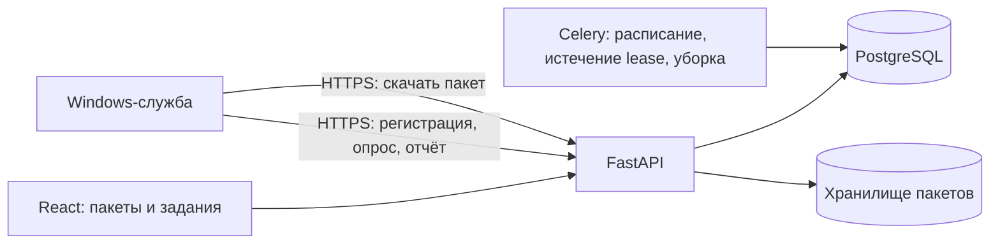

# План управления установкой ПО на Windows-машинах

Дата: 31 октября 2026 года  
Статус: проект решения, перед реализацией проверить матрицу ОС и сетевую доступность.

## Цель

Из интерфейса InfraScope публиковать версии программ и назначать их компьютерам и кассам. Windows-служба на каждой машине сама связывается с сервером, получает задание, устанавливает пакет и сообщает результат. Система должна принимать пакеты разных поставщиков и форматов, включая приложения, драйверы и собственные установочные сценарии.

«Любой пакет» означает, что администратор может упаковать файлы и описать установку для конкретного продукта. Универсальной команды тихой установки нет: параметры установщика, определение версии, зависимости и перезагрузка задаются для каждого пакета. Первая версия не должна обещать автоматическую установку приложения, у которого нет поддерживаемого тихого режима.

## Решения для первой версии

- Контрольная плоскость остаётся в InfraScope: FastAPI, PostgreSQL, Celery и React.
- Установка выполняется отдельной Windows-службой на Go. Не расширять `media-agent-go`: он работает в пользовательском контексте и обслуживает воспроизведение, а установщику нужны системные права.
- Устройства инициируют все соединения к серверу по HTTPS. InfraScope не открывает удалённую PowerShell-сессию и не запускает установки через WinRM.
- Пакет версии неизменяем после публикации. Исправление пакета создаёт новую версию.
- Пакет представляет собой ZIP с манифестом и сценариями `install.ps1`, `detect.ps1`, при необходимости `uninstall.ps1`, `preinstall.ps1` и `postinstall.ps1`. Сценарий может запустить MSI, EXE, PnPUtil или другой поставляемый файл.
- Выполнять можно только сценарий из опубликованного пакета. API не предоставляет отдельный вызов «выполни команду на устройстве».
- Агент получает уникальные учётные данные на устройство. Общий fleet-токен запрещён.
- Первая версия работает только с явно выбранными устройствами Windows. Массовое назначение всем строкам инвентаря выключено.
- Сначала поддерживаются установка, обновление, обнаружение результата и явная отметка о требуемой перезагрузке. Автоматическую перезагрузку и обновление драйверов на рабочих кассах оставить на следующий этап.

## Архитектура



Установка в Celery не выполняется. Celery помогает назначать и обслуживать задания, но локальный агент запускает установщик, чтобы процесс пережил перезапуск API или worker.

Артефакты хранятся в отдельном каталоге на диске сервера, например `/var/lib/infrascope/software-packages`, подключённом как Docker volume. В PostgreSQL хранить только метаданные. Загрузку файла обслуживать через авторизованный маршрут с ограничением размера; не переиспользовать публичную раздачу файлов `media-service`.

На старте можно использовать текущий инвентарь как источник списка машин. Для идентичности агента завести отдельную таблицу, связанную с `Computer` и `CashRegister`; одна запись агента может ссылаться на обе строки, если в инвентаре это одна физическая машина. Не добавлять установочные поля в `RemoteAccessDevice`.

## Формат пакета

ZIP-архив содержит манифест и нужные файлы. Минимальный манифест:

```json
{
  "id": "vendor.application",
  "version": "5.4.2",
  "platform": "windows",
  "architectures": ["x64"],
  "min_os": "10.0",
  "install": "install.ps1",
  "detect": "detect.ps1",
  "uninstall": "uninstall.ps1",
  "timeout_seconds": 1800,
  "reboot_policy": "report_only",
  "files": {
    "setup.msi": "<sha256>"
  }
}
```

Манифест должен также иметь `schema_version`. Валидировать длину и формат полей, допустимые относительные пути, отсутствие `..` и абсолютных путей, лимит числа файлов, общий размер архива, симлинки и дубли имён. При распаковке запрещать выход за рабочий каталог агента.

`install.ps1` принимает только документированные параметры окружения агента: путь к каталогу пакета, текущую версию и ID задания. Скрипт использует тихие параметры поставщика, ожидает завершения процесса и возвращает код установки. `detect.ps1` возвращает установленную версию или «не установлено». Секреты магазина, домена и пользователя в аргументы и логи не передавать.

При публикации InfraScope вычисляет SHA-256 всех файлов и подписывает каноническое содержимое манифеста ключом подписи пакетов. Агент содержит только открытый ключ и проверяет подпись до запуска сценариев, а затем хеши файлов. Если поставщик подписал MSI/EXE/драйвер, пакетный сценарий дополнительно проверяет Authenticode и ожидаемого издателя. Подпись InfraScope удостоверяет одобрение пакета администратором; подпись поставщика удостоверяет происхождение бинарного файла. Приватный ключ подписи хранить отдельно от репозитория и не в таблице БД.

## Модели данных

Начать с пяти сущностей. Поля уточнить при первой миграции, не добавлять поля «на будущее» без сценария использования.

### `SoftwareAgent`

- ID агента, уникальный нормализованный hostname;
- ссылки на строку `Computer` и/или `CashRegister`;
- хеш уникального токена устройства, время его ротации;
- версия агента, Windows build/edition/architecture;
- `last_seen_at`, состояние `active`/`revoked`;
- опционально: свободное место на системном диске и результаты инвентаризации ПО.

Секрет агента создать при регистрации один раз; сохранять в БД только хеш. На диске Windows хранить в каталоге с ACL, доступным `SYSTEM` и администраторам. Запросы агента проверять по TLS и его индивидуальному секрету.

### `SoftwarePackage`

Логический продукт: ID, название, издатель, описание, активность. Уникальность продукта не привязывать к одной версии.

### `SoftwarePackageVersion`

Неизменяемая опубликованная версия: продукт, версия, digest архива, путь/ключ в файловом хранилище, JSON-манифест, подпись InfraScope, размер, автор загрузки, автор публикации, даты и состояние `draft`/`published`/`retired`.

### `SoftwareDeployment` и `SoftwareDeploymentJob`

`SoftwareDeployment` задаёт пакет, список выбранных агентов, инициатора, время начала/истечения и лимит параллельных установок. На каждое устройство создать одну `SoftwareDeploymentJob` с состоянием, lease, попыткой, кодом завершения, версией до/после, коротким текстом результата и временем начала/окончания.

События установки сохранять отдельно или как append-only записи: получение задания, скачивание, проверка подписи, запуск, код выхода, требование перезагрузки, итоговая проверка. Ограничить объём stdout/stderr, не писать туда токены и переменные окружения.

Основные состояния задания:

```text
queued → claimed → downloading → verifying → installing
                                      ├→ succeeded
                                      ├→ reboot_required
                                      └→ failed
```

Ожидающее задание можно отменить. После начала установки UI сообщает, что отмена не обещана: принудительно убивать любой установщик опасно. `reboot_required` не означает успех: после следующего запуска агент снова проверяет пакет и переводит задание в `succeeded` или `failed`.

## Протокол агента

1. **Регистрация.** Администратор выдаёт короткоживущий одноразовый код регистрации конкретному устройству. Установочный bootstrap получает код через GPO или подготовленный локальный пакет. Сервер проверяет hostname и инвентарную запись, создаёт `SoftwareAgent`, отзывает код и возвращает уникальный токен. Не оставлять bootstrap-файл с кодом после регистрации.
2. **Heartbeat.** Агент отправляет hostname, версию агента, Windows build, архитектуру, свободное место, текущие задания и время. Сервер обновляет `last_seen_at`.
3. **Получение задания.** Агент запрашивает одно подходящее задание. Сервер атомарно создаёт lease с владельцем и сроком истечения; для агента выдаётся максимум одно активное задание.
4. **Загрузка.** Агент получает авторизованную ссылку или маршрут с ограниченным по времени токеном. Скачивает архив во временный каталог, проверяет размер, подпись манифеста и хеши файлов, затем распаковывает в изолированный каталог.
5. **Установка.** До запуска `detect.ps1` проверяет, нужно ли вообще устанавливать пакет. Агент запускает `install.ps1` с лимитом времени, собирает ограниченный вывод и преобразует коды MSI/сценария в результат задания. Установка должна быть идемпотентной: повторный запуск после потери отчёта сначала проверяет желаемое состояние.
6. **Отчёт.** На каждом этапе агент отправляет обновление состояния. Если сеть пропала, он сохраняет короткое локальное состояние задания и повторяет отправку с backoff; не перезапускает установщик только из-за потери HTTP-ответа.
7. **Lease и повтор.** Celery периодически закрывает протухшие lease как `lost` или возвращает задание в `queued` только если агент подтвердил, что установка не начиналась. Не повторять автоматически установку с неизвестным исходом.

В первой версии использовать обычный HTTPS с полной проверкой сертификата. Если сервер использует внутренний CA, доставлять корневой сертификат на устройства управляемым способом. Не отключать проверку TLS. При ротации ключа подписи поддержать период доверия к двум открытым ключам.

## API, предварительный контракт

Маршруты администратора защищаются существующей сессией и правами InfraScope. Маршруты агента используют отдельную dependency для токена устройства.

```text
POST   /api/v1/software-deployment/packages                 загрузить черновик
POST   /api/v1/software-deployment/packages/{id}/publish    проверить и опубликовать
GET    /api/v1/software-deployment/packages                 каталог
POST   /api/v1/software-deployment/deployments              создать развёртывание
GET    /api/v1/software-deployment/deployments/{id}         состояние и задания
POST   /api/v1/software-deployment/jobs/{id}/cancel         отменить до установки

POST   /api/v1/software-agent/enroll                        одноразовая регистрация
POST   /api/v1/software-agent/heartbeat                     heartbeat
POST   /api/v1/software-agent/jobs/claim                    получить задание
POST   /api/v1/software-agent/jobs/{id}/events              статус и результат
GET    /api/v1/software-agent/packages/{version_id}/file    скачать пакет
```

Перед возвратом задания сервер сверяет активность агента, совместимость ОС/архитектуры и наличие другого активного задания. Все изменения статуса проверяют, что job принадлежит агенту, который прислал запрос. Rate limit не должен использовать один общий IP всех машин за nginx: ключом служит agent ID.

## Структура кода

Конкретные файлы backend:

```text
app/domains/software_deployment/
  __init__.py
  models.py                         SoftwareAgent, SoftwarePackage, SoftwarePackageVersion,
                                    SoftwareDeployment, SoftwareDeploymentJob
  schemas.py                        Pydantic-манифесты и API-схемы
  service.py                        пакеты, публикация, назначения и переходы состояний
  package_store.py                  файлы ZIP: загрузка, проверка, выдача
  agent_auth.py                     регистрация, проверка и отзыв ключей агента
app/api/routes/software_deployment.py  админские маршруты пакетов и заданий
app/api/routes/software_agent.py        маршруты регистрации, heartbeat, claim, events и файла
app/api/api_v1/router.py               импорт и include_router для двух новых роутеров
app/domains/registry.py                импорт models нового домена для SQLModel/Alembic
app/worker/tasks.py                   уборка протухших lease и заданий
app/worker/celery_app.py              расписание уборки, если задача должна идти по Beat
app/core/config.py                    путь к каталогу пакетов, лимиты и ключ подписи
docker-compose.yml                    постоянный volume для пакетов
alembic/versions/<revision>_software_deployment.py  миграция, созданная Alembic
```

`app/api/routes/remote_access.py` остаётся для RustDesk, а `app/api/routes/remote_access_push.py` остаётся для его текущего WinRM push. Новые маршруты туда не добавлять. В `app/api/api_v1/router.py` подключить `software_deployment.router` с префиксом `/software-deployment`, а `software_agent.router` с префиксом `/software-agent`.

Frontend:

```text
frontend/src/api/softwareDeployment.ts
frontend/src/pages/SoftwareDeploymentPage.tsx
frontend/src/pages/SoftwareDeploymentPage.test.tsx
frontend/src/App.tsx                  lazy import и маршрут /software-deployment
frontend/src/components/Layout.tsx    пункт навигации и заголовок страницы
```

Агент:

```text
clients/software-agent-go/
  go.mod
  cmd/software-agent/main.go
  internal/config/config.go
  internal/protocol/types.go
  internal/client/client.go
  internal/client/auth.go
  internal/package/manifest.go
  internal/package/verify.go
  internal/package/extract.go
  internal/runner/runner_windows.go
  internal/service/service_windows.go
  internal/service/service_stub.go
```

Сначала собрать агент как консольную программу, чтобы отладить протокол в Windows VM; затем добавить запуск как Windows Service и команды `install`, `uninstall`, `status`. Не смешивать логику HTTP, проверки пакета и запуск процесса в одном `main.go`.

Тесты, которые добавить по мере появления кода:

```text
tests/unit/domains/test_software_deployment.py
tests/integration/api/test_software_deployment.py
tests/integration/api/test_software_agent.py
clients/software-agent-go/internal/package/verify_test.go
clients/software-agent-go/internal/runner/runner_test.go
frontend/src/pages/SoftwareDeploymentPage.test.tsx
```

## Этапы реализации

### Этап 0. Проверить условия парка

До изменения production собрать таблицу: hostname, источник инвентаря, Windows edition/build, архитектура, модель ПК/кассы, доступность HTTPS-сервера из магазина, наличие GPO или альтернативы для начальной установки службы, типичные размеры пакетов и рабочие окна. Отдельно отметить Windows XP/7 и другие версии вне подтверждённой поддержки агента. Проверить, есть ли дубли инвентаря одной машины между `Computer` и `CashRegister`.

**Готово, когда:** выбрана поддерживаемая тестовая группа и подтверждено, что машины сами достигают сервера по HTTPS. Неподдерживаемые старые ОС выделены в отдельный backlog, не получают задания.

### Этап 1. Контракты и безопасное хранение

Описать JSON-манифест, состояния и Pydantic-схемы. Добавить валидацию ZIP и безопасный `package_store.py`: лимиты размера, нормализация путей, атомарная запись, запрет перезаписи опубликованного файла, SHA-256. Определить, где на production лежат volume и ключ подписи, как их резервировать и ротировать.

**Готово, когда:** некорректный архив, плохой путь, неподписанный или повреждённый манифест отклоняется до публикации.

### Этап 2. Серверная модель и регистрация агента

Добавить модели, Alembic-миграцию, регистрацию домена в `app/domains/registry.py`, админские маршруты и агентную аутентификацию. Реализовать создание, отзыв и ротацию индивидуального токена. Сначала heartbeat и экран списка агентов, без установки ПО.

**Готово, когда:** известный одноразовый код регистрирует только одну ожидаемую машину; повторный и чужой код отклоняется; отзыв ключа немедленно прекращает доступ; heartbeat виден в InfraScope.

### Этап 3. Go-агент без запуска пакетов

Сделать конфиг, HTTPS-клиент, регистрацию, heartbeat, polling, lease и локальное логирование. Отлаживать на Windows VM через консольный режим, затем оформить Windows Service. Настроить ACL каталога конфигурации, ключа, логов и кэша. Добавить подписанное обновление агента после того, как базовый протокол устойчив.

**Готово, когда:** агент устанавливается и удаляется, переживает перезапуск ОС, повторяет запросы при недоступном сервере и не принимает задание другого устройства.

### Этап 4. Сквозной тестовый пакет и очередь

Добавить загрузку черновика, публикацию, подпись манифеста, выдачу пакета, обработку lease и отчёты. Первый пакет сделать безопасным тестовым: сценарий создаёт marker-файл, `detect.ps1` находит его и возвращает версию. Проверить дважды: второй запуск должен увидеть уже установленное состояние и не повторять действие.

**Готово, когда:** оператор видит все этапы задания; серверный перезапуск не теряет историю; обрыв сети во время загрузки или после установки не приводит к слепому повтору; хеш и подпись проверяются агентом до запуска.

### Этап 5. Каталог и интерфейс публикации

Добавить в React: каталог продуктов и версий, экран загрузки, просмотр манифеста и digest, явное действие «Опубликовать», список агентов с последним heartbeat. Только суперпользователь публикует пакеты и запускает задания в первой версии. Не показывать и не редактировать секрет агентной аутентификации после выдачи.

**Готово, когда:** черновик нельзя назначить; опубликованная версия неизменяема; история показывает автора публикации и инициатора задания.

### Этап 6. Первое настоящее приложение

Выбрать обратимое приложение, для которого известны тихие параметры. Подготовить пакет с точной версией, скриптом установки и проверкой результата. Проверить установку на чистой VM, обновление поверх предыдущей версии, повторное выполнение, код «требуется перезагрузка», нехватку места и прерывание сети.

**Готово, когда:** пакет проходит сценарии в тестовой VM и на одной некритичной реальной машине без участия пользователя, а ошибка даёт читаемую причину и пригодна для ручного повтора.

### Этап 7. Кампании и пилот по магазинам

Сделать выбор устройств по текущему инвентарю и явный предпросмотр: hostname, магазин, ОС, версия до установки, причины исключения. Создавать по одному job на агент. Ограничить параллелизм кампании и иметь `expires_at`. Для первого пилота запускать вручную по одному магазину; не делать автоматическую волну по всему парку.

Пилот: 2–3 тестовых ПК, затем одна тестовая касса только с приложением, влияющим на её ПО, но не драйвер. Остановка кампании запрещает новые задания; уже выполняющиеся установщики не убиваются автоматически.

**Готово, когда:** оператор может понять охват до старта, отложить следующие устройства, увидеть достигнутый процент успеха и остановить кампанию без создания новых запусков.

### Этап 8. Драйверы и расширение поддержки

После стабильного пилота добавить шаблон пакета для драйвера с проверкой модели/Hardware ID, подписанного INF и явной политикой перезагрузки. Устанавливать только на точную модель из allowlist, пилотировать на резервном устройстве. В отдельной задаче решить, как хранить предыдущую версию драйвера и восстанавливать устройство при сбое. Потом расширять список Windows-версий и форматов по фактическим пакетам.

## Проверки и критерии качества

- Unit: проверка манифеста и архива, безопасная распаковка, подпись и digest, переходы состояний, lease, истечение токена, идемпотентность задания.
- API: авторизация администратора, одноразовая регистрация, агент A не читает/не обновляет job агента B, revoked agent получает 401, непубликованный пакет не выдаётся.
- Agent: тестовый сервер, плохой TLS-сертификат, неверная подпись, изменённый файл, нехватка места, timeout, потеря сети, процесс установщика с каждым разрешённым кодом выхода.
- Windows VM: установка службы и восстановление после reboot, ACL, MSI/EXE, кириллические пути и текст ошибок.
- Сборка проекта: quality gate backend и проверки frontend; агент собирается для выбранных целевых Windows-версий. Реальные устройства использовать только на пилоте.
- Не запускать задачи установки тестовой кампании на production inventory до явного выбора тестовых endpoints.

## Эксплуатация

- Каталог пакетов включить в резервное копирование; проверить восстановление вместе с ключом подписи. Без ключа восстановить файлы можно, но агент не примет новые подписи старого ключа.
- Метрики: число активных/проваленных заданий, длительность этапов, размер загрузок, старые агенты, offline агенты, ошибки signature/hash.
- Хранить короткие логи установки с лимитом размера и сроком хранения; полный MSI-лог не принимать автоматически, пока не определена политика очистки секретов.
- Окна обслуживания касс не пересекать с известными ночными рестартами сервисов InfraScope. Развёртывание приложения не должно перезапускать backend/worker.
- Отдельный runbook: остановить новые назначения, отозвать токен агента, снять опубликованную версию, переиздать пакет, повторно назначить предыдущую версию и разобрать устройство через локальный доступ.

## Что не делать в первой версии

- Не строить отдельный брокер сообщений или новую микрослужбу: HTTPS polling достаточно для парка текущего размера.
- Не хранить бинарные файлы в PostgreSQL, Celery или Redis.
- Не давать оператору текстовое поле «выполнить команду» на выбранных машинах.
- Не выполнять автоматический rollout на весь парк и не перезагружать кассы по умолчанию.
- Не обновлять драйверы и пользовательские приложения одним общим сценарием без проверки на их целевых моделях.
- Не поддерживать неподтверждённые старые Windows-версии обещанием; сначала проверить agent runtime, TLS и службу в VM.

## Первый рабочий кусок

Порядок первых изменений:

1. Зафиксировать матрицу Windows и выбрать несколько тестовых машин.
2. Согласовать JSON-манифест и state machine в `app/domains/software_deployment/schemas.py`.
3. Добавить регистрацию агента и heartbeat, не включая запуск установок.
4. Создать Windows-службу, которая регистрируется и отображается online.
5. Добавить тестовый подписанный ZIP-пакет и провести одно задание end-to-end.
6. Только после этого добавлять загрузку реальных приложений и кампании.

Так разделяется риск агента, который имеет права `SYSTEM`, и риск установщика. В каждом этапе есть работающий результат, который можно отдельно проверить до следующего.

## Источники

- [Документация по удалённой установке Windows-приложений в Kaspersky Security Center](https://support.kaspersky.com/ksc/14/en-US/155189.htm) — справочно о модели «пакет + задание + группа устройств»; InfraScope не зависит от Kaspersky.
- [Учётные записи служб Windows](https://learn.microsoft.com/en-us/windows/win32/services/service-user-accounts) — контекст и права Windows-службы.
- [PnPUtil: команды управления драйверами](https://learn.microsoft.com/en-us/windows-hardware/drivers/devtest/pnputil-command-syntax) — установка INF-пакетов.
- [Исследование вариантов развёртывания](windows-software-deployment-research-2026-10.md) — обзор OPSI, WinRM, PDQ, Intune, WinGet и текущего состояния InfraScope.
